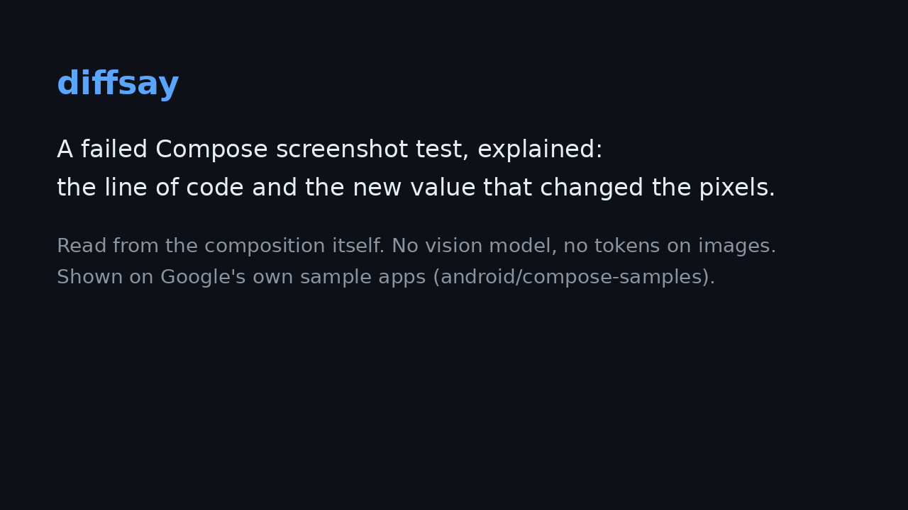

# diffsay

**A failed Jetpack Compose screenshot test, explained: the line of code and the value that changed the pixels.**



Your Roborazzi run says 7 screenshots changed and gives you 21 PNGs. diffsay reads the
composition behind each screenshot and tells you why:

```text
$ diffsay scan app/build --source app
5 failed screenshots; 5 traced to 2 cause(s) in code:
  ReplyEmailListItem.kt:129 now uses titleMedium (Type.kt:50) instead of bodyLarge
      breaks 5: ReplyAppPreview.WITH_BACKGROUND, +4 more
  padding(12.dp) is written at ReplyEmailListItem.kt:81
      breaks 5: ReplyAppPreview.WITH_BACKGROUND, +4 more
```

That's a real run on Google's [Reply](https://github.com/android/compose-samples/tree/main/Reply)
sample, after a two-line change. Theme edits are traced to the theme file, not to the dozens of
`Text`s that use it:

```text
16 failed screenshots; 16 traced to 1 cause(s) in code:
  lineHeight = 27.sp is written at Type.kt:71
      breaks 16: HistoryPostPreviewDark, HistoryPostPreview, PreviewHomeListDrawerScreenDark, +13 more
```

It's built for coding agents (Claude Code, Cursor, Codex…) as much as for people: a ~30-token
answer instead of loading two or three screenshots per failure and searching the code for a cause.
No model, no network, deterministic.

## Quick start

You need a module with [Roborazzi](https://github.com/takahirom/roborazzi) on Robolectric.

```bash
pip install git+https://github.com/trOnk12/diffsay
diffsay init app        # copies two Kotlin files into app/src/test and prints the Gradle lines
```

If Roborazzi generates your `@Preview` tests, the Gradle part is one line in the block you already
have (tested with Roborazzi 1.74 and 1.76):

```kotlin
roborazzi {
    generateComposePreviewRobolectricTests {
        enable = true
        useScanOptionParametersInTester = true
        testerQualifiedClassName = "dev.diffsay.DiffsayPreviewTester"   // ← this
    }
}
dependencies { testImplementation("androidx.compose.ui:ui-tooling-data") }
```

For hand-written tests, use `compose.captureWithCauses("…/checkout.png") { CheckoutScreen() }`
instead of `setContent` + `captureRoboImage` ([details](android/README.md)).

Then, as usual:

```bash
./gradlew recordRoborazziDebug          # goldens (+ <name>.slots.json.gz beside each)
# … change code …
./gradlew compareRoborazziDebug         # or verifyRoborazziDebug
diffsay scan app/build --source app     # why each screenshot changed
diffsay scan app/build --source app --markdown   # the same, as a PR-comment table
```

In CI: [post the causes on the pull request](docs/github-actions.md).

## How it works

Android Studio's Layout Inspector knows which composable drew which pixels because the
composition's slot table records every call's source file and line, bounds, parameter values and
modifier chain. `SlotRecorder.kt` reads that table inside the Robolectric test, through the public
`ui-tooling-data` API, and saves it beside the screenshot. `diffsay scan` then:

1. aligns the golden and actual compositions by content, so added, removed, reordered and lazy
   rows don't shift everything else;
2. diffs the values each call remembered, after normalising runtime noise (identity hashes,
   CompositionLocal maps, generated keys, shuffled sample data);
3. keeps the changes inside the pixels that actually changed, at the nearest call in *your* code;
4. finds where the new value is written in your sources: the literal at the call, the theme block
   whose other values match (`Type.kt:71`), or the theme style a `Text` switched to;
5. groups failures by cause, so one edit is one line however many previews it broke.

## Evidence

Edits are **sampled at random** from every visual literal in an app's UI code, theme files
included (dp, sp, colours, font weights, alpha, maxLines). Each sample was committed before it was
run, and each held-out row was scored with an engine committed before that sample was seen. Each
edit is patched in, compiled, and compared with real Roborazzi + Robolectric runs of the app's
own `@Preview`s.

**Explained** = a top cause line points at the edited line *and* names the new value.
**Located** = it points at the edited line.

| App (android/compose-samples), sample | Engine | Visible edits | Explained | Located |
| --- | --- | --- | --- | --- |
| JetNews, seed 2027, **held-out** | v5, frozen | 28 | **25 (89%)** | **28 (100%)** |
| JetNews, seed 2026, **held-out** | v4, frozen | 17 | **14 (82%)** | 14 |
| Jetsnack, seed 7, **held-out** | v4, frozen | 19 | 12 (63%) | 12 |
| Jetsnack, seed 42 | first version | 25 | 5 (20%) | — |
| All four, *current engine, after tuning on them* | v7 | 89 | 72 (81%) | 77 (87%) |

"Visible" edits are those that changed at least one preview's pixels. The first version was
drowned by composition noise on Compose 1.12; the rows below it record how that was fixed.
Raw outputs, the samplers, the harness changes and the runner are in [`bench/android/`](bench/android/).

Misses, honestly: drawing inside lambdas (`drawBehind { }`, `Canvas`) is invisible to the slot
table (diffsay says `composition identical: the change is in drawing code…`), `maxLines` isn't
recorded (the resized `Text` is located but the value isn't named), and values passed through
another composable's parameter (`Surface(elevation = …)`) are named where they're applied.

## Compared with

- **Roborazzi** (1.69+) dumps a semantics tree beside each screenshot for agents, and has AI
  image assertions. It doesn't diff the trees or point at code. diffsay plugs into it.
- **Android Studio / Compose Preview Screenshot Testing / Paparazzi**: golden, actual and diff
  images, plus a match percentage.
- **Emerge / Sentry Snapshots**: hosted image diffs per PR.

As of October 2026, none of them maps a failed screenshot to the source line and value that
changed it.

## Also: pixel mode, for any screenshots

`diffsay before.png after.png --crops out/x` names and measures what changed between two
screenshots from anywhere (Paparazzi, emulator, iOS, web): moved Npx, hex colours, opacity, glyph
height, line pitch. It writes a zoomed before/after strip, so an agent can look at ~200 image
tokens instead of ~2,700. On the [DiffSpot](https://huggingface.co/datasets/tencent/DiffSpot)
benchmark (4,080 held-out web pairs), it names the property and direction for 60% of changes and
never reports a change on identical screens ([details](bench/README.md)).

## Limits

- Android, Jetpack Compose, Robolectric (Roborazzi). Paparazzi support for the composition part
  is possible but not done.
- Robolectric renders on the JVM; it isn't a device.
- Each screenshot gets a gzipped composition dump beside it (~100 KB for a full screen).

## License

MIT
