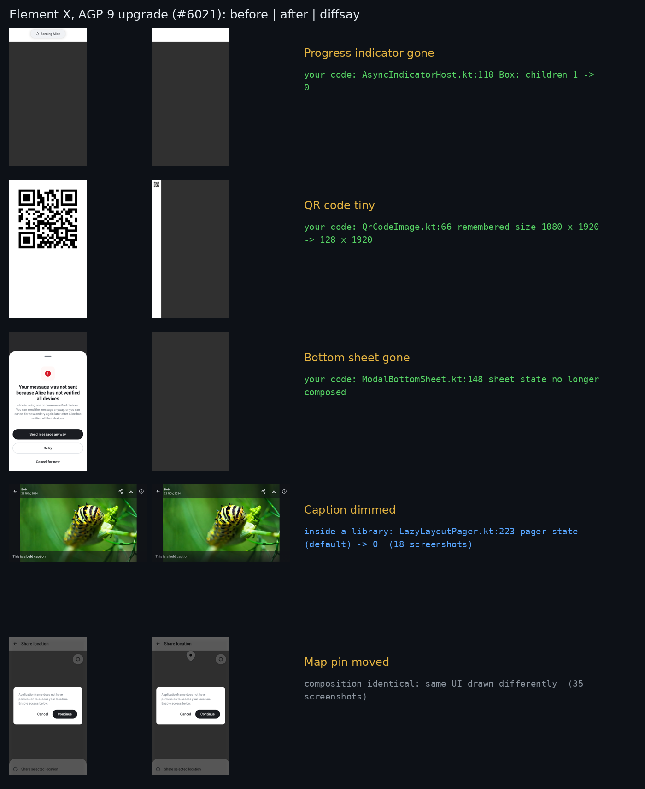

# Case study: Element X's AGP 9 upgrade

[Element X Android](https://github.com/element-hq/element-x-android) keeps about 3,300 Paparazzi
goldens. Its upgrade to Android Gradle Plugin 9 ([#6021](https://github.com/element-hq/element-x-android/pull/6021),
June 2026) also moved Kotlin to 2.4, Gradle to 9.5 and Paparazzi to 2.0.0-alpha05. A bot re-recorded
**143 screenshots**. A maintainer reviewed them by eye and left ten notes: *"Error banner has vanished
here."*, *"QrCode is not correctly displayed here."*, *"Layout is broken here."*, … and merged with
*"Maybe we can merge the PR with this limitations?"*. No root cause was found.

There's no UI code in that diff. Every screenshot change came from a toolchain or library.

## What diffsay says

We put `snapshotWithCauses` in Element X's own Paparazzi harness (a one-line change, plus the
42 preview functions behind the 143 changed goldens), recorded at the commit before the upgrade
(`37fed3e8`) and verified at the upgrade (`f0a6cba6`). 61 of those screenshots differ in our
environment:

```text
61 failed screenshots: 8 changed by your code (5 cause(s)); 18 changed inside a library (1); 35 with an identical composition (renderer or drawing):
  inside a library, not in your code: LazyLayoutPager.kt:223 (group): value 2: (default) -> 0
      breaks 18: impl.viewer_MediaViewerViewLandscape_18_en, +17 more
  ModalBottomSheet.kt:148 remember: remember removed
      breaks 3: sendfailure.resolve_ResolveVerifiedUserSendFailureView_Day_1_en, +2 more
  AsyncIndicatorHost.kt:110 Box: value 1: …ayoutNode children: 1 … -> …ayoutNode children: 0 …
      breaks 2: roommembermoderation.impl_RoomMemberModerationView_Day_7_en, +1 more
  ShowQrCodeView.kt:67 AnimatedContent: value 2: (default) -> DATA in "Open MyApp on the other device"
      breaks 1: screens.qrcode_ShowQrCodeView_Night_0_en
  ElementTheme.kt:106 isDark: isDark added
      breaks 1: impl.blockedusers_BlockedUsersView_Day_5_en
  QrCodeImage.kt:66 remember: value 1: MutableState(value=1080 x 1920) -> MutableState(value=128 x 1920)
      breaks 1: libraries.qrcode_QrCodeView_en
  composition identical: the same UI drawn differently
      in 35: impl.share_ShareLocationView_Day_2_en, impl.share_ShareLocationView_Day_3_en, … +32 more
```

61 image pairs become three kinds of change, each with a place to look:



- **The UI state changed (8).** The QR code collapses because `QrCodeImage` now measures itself at
  128 px wide instead of 1080. The "Banning Alice" progress indicator and the "Your message was not sent"
  bottom sheet are no longer *composed* at all (`AsyncIndicatorHost`, `ModalBottomSheet`). These are
  behaviour changes a user could see, and the line to start debugging from.
- **A library changed underneath (18).** Every media-viewer screenshot traces to one value in Compose's
  `LazyLayoutPager`; the app's code and composition are otherwise identical.
- **Only the drawing changed (35).** Same composition, different pixels: the renderer (Paparazzi's
  layoutlib) draws text, the map pin and icons differently. Safe to re-record unless the new pixels are
  wrong on a device.

We checked each kind against the images (the figure above). This is the information the reviewer was
reconstructing by eye across 143 screenshots, and that images alone don't contain: *why* the banner
vanished is not in the pixels.

## Reproduce

[`bench/element-x/`](../bench/element-x/): `ex_patch.py` applies the harness change, `ex_cycle.sh`
records before, verifies after and scans (about 20 minutes on 4 cores after the first build), and
`scan.txt` is the full output.

Limits: 82 of the 143 golden changes the bot recorded on Element's CI didn't show up as a difference
when we rendered both commits on one machine, so the analysis covers 61. The figure uses screenshots of Element X's previews
(AGPL-3.0); all credit to its authors.
